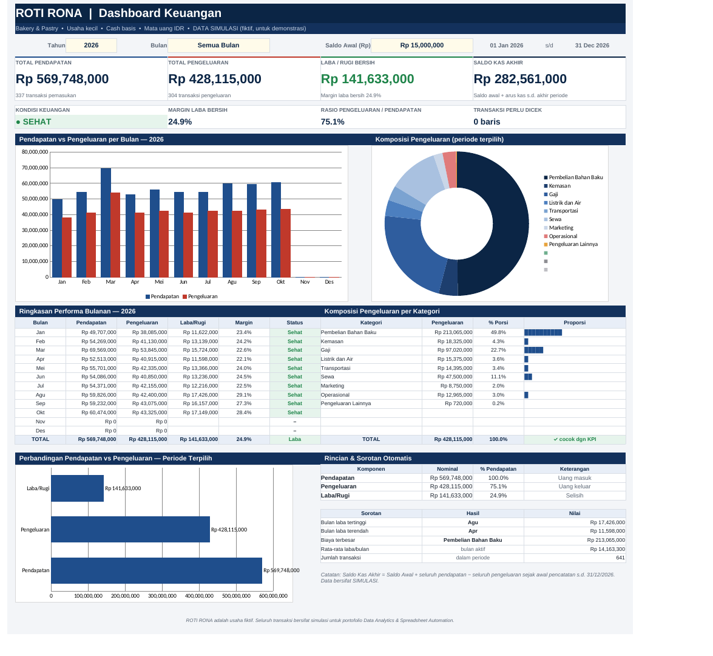

# ROTI RONA — Sistem Pembukuan & Dashboard Keuangan UMKM

Proyek portofolio **Data Analytics & Spreadsheet Automation**: sistem pembukuan *cash basis* untuk UMKM fiktif **ROTI RONA** (bakery & pastry, usaha kecil, transaksi harian, IDR) di **Google Sheets**, dibangun otomatis dengan **Google Apps Script** — lengkap dengan dashboard KPI, grafik, dropdown, conditional formatting, dan data simulasi.



> Semua transaksi adalah **data simulasi** (fiktif). Tangkapan layar dirender dari file `.xlsx` hasil build lewat LibreOffice; tampilan di Google Sheets sangat mirip.

## Status penting (transparansi)

- Spreadsheet **belum dibuat secara online** oleh saya: lingkungan pengembangan tidak punya akses untuk membuat Google Sheets baru di akun Anda. Anda menghasilkannya sendiri dengan menjalankan `Code.gs` (lihat [docs/INSTALASI.md](docs/INSTALASI.md)).
- `Code.gs` diuji dengan **mock Apps Script di Node.js** (menjalankan kode asli, merekam semua operasi) dan formula hasilnya dihitung ulang dengan **LibreOffice**. Pengujian langsung di runtime Google belum dilakukan; rincian di bagian [Validasi](#validasi).

## Isi repositori

| File | Fungsi |
|---|---|
| `Code.gs` | Google Apps Script: `setup()` membangun 4 sheet, formula, validasi, CF, grafik, data demo |
| `appsscript.json` | Manifest (zona waktu Asia/Jakarta, V8) |
| `ROTI_RONA_Pembukuan.xlsx` | Alternatif Excel / impor ke Sheets (dihasilkan dari `Code.gs` yang sama) |
| `sample_transactions.csv` | 1.409 transaksi simulasi (Jan 2025 – Okt 2026) |
| `docs/INSTALASI.md` | Panduan menghasilkan Google Sheets |
| `tools/` | `mock_sheets.js`, `build_xlsx.py`, `validate.py` (build & uji) |

## Struktur workbook

| Sheet | Fungsi |
|---|---|
| **DASHBOARD** | Filter Tahun & Bulan, input Saldo Awal, 4 KPI, indikator kondisi, 3 grafik, tabel bulanan, komposisi kategori, sorotan otomatis |
| **TRANSAKSI** | Input harian. Kolom: Tanggal, ID Transaksi, Jenis, Kategori, Keterangan, Metode, Nominal, Arus Kas, Bulan (+ *Cek Data*). 5.000 baris siap pakai |
| **KATEGORI** | Daftar kategori + jenis (sumber dropdown), metode pembayaran, tahun, bulan |
| **PETUNJUK** | Panduan: tambah transaksi, pilih kategori, baca dashboard, ubah periode, tambah kategori, koreksi kesalahan |

## Formula utama

Periode ditentukan dua sel bantu di DASHBOARD (`Q3` = tanggal mulai, `Q4` = tanggal akhir):

```
Q3 = IF(E5="Semua Bulan", DATE(C5,1,1), DATE(C5, MATCH(E5,KATEGORI!K6:K17,0), 1))
Q4 = IF(E5="Semua Bulan", DATE(C5,12,31), EOMONTH(Q3,0))
```

| Metrik | Formula |
|---|---|
| Total Pendapatan | `SUMIFS(TRANSAKSI!G:G, TRANSAKSI!C:C,"Pendapatan", TRANSAKSI!A:A,">="&Q3, TRANSAKSI!A:A,"<="&Q4)` |
| Total Pengeluaran | sama, kriteria `"Pengeluaran"` |
| Laba/Rugi Bersih | `Total Pendapatan − Total Pengeluaran` |
| Saldo Kas Akhir | `Saldo Awal + SUMIFS(Pendapatan, tanggal ≤ Q4) − SUMIFS(Pengeluaran, tanggal ≤ Q4)` |
| Arus Kas (TRANSAKSI) | `IF(Jenis="Pendapatan", Nominal, IF(Jenis="Pengeluaran", −Nominal, ""))` |
| Bulan (TRANSAKSI) | `DATE(YEAR(A), MONTH(A), 1)` (ditampilkan “mmmm yyyy”) |
| ID Transaksi | `"TRX-" & TEXT(ROW()-4,"00000")` |
| Cek Data | `COUNTIFS` pada KATEGORI memeriksa pasangan Kategori–Jenis |
| Tabel bulanan | `SUMIFS` per bulan dengan `DATE`/`EOMONTH`; status Sehat/Waspada/Rugi dengan `IF` |
| Komposisi kategori | `INDEX/MATCH` menarik daftar kategori Pengeluaran dari KATEGORI, lalu `SUMIFS` per kategori |

Dashboard memakai **referensi kolom penuh** (`TRANSAKSI!G:G`), bukan rentang tetap, sehingga transaksi baru — termasuk di bawah baris 5.004 — otomatis terhitung. Formula ditulis dengan sintaks Inggris (pemisah koma), sehingga `Code.gs` memaksa locale spreadsheet `en_US` saat setup (locale Indonesia membuat semua formula `#ERROR!`). Untuk tanggal/angka format Indonesia, ubah **File → Settings → Locale → Indonesia** setelah setup; Google Sheets mengonversi formula otomatis.

**Indikator kondisi:** SEHAT (margin ≥ 10%), WASPADA (laba, margin < 10%), RUGI (laba < 0), BELUM ADA DATA.

## Cara menggunakan

1. Jalankan `setup()` (lihat [docs/INSTALASI.md](docs/INSTALASI.md)).
2. Catat transaksi di **TRANSAKSI** (kolom putih saja; pilih dari dropdown).
3. Pilih **Tahun/Bulan** dan ubah **Saldo Awal** (sel kuning) di **DASHBOARD**.
4. Tambah kategori di **KATEGORI**. Mulai data asli lewat menu **ROTI RONA → Hapus data simulasi**.

## Validasi

`python3 tools/validate.py` menghitung ulang `.xlsx` dengan LibreOffice dan membandingkan 4 KPI, 12 bulan, dan komposisi kategori dengan perhitungan manual independen (pandas) pada data CSV. Hasil terakhir: **semua 100 pemeriksaan lulus** pada 11 skenario.

| Skenario | Hasil |
|---|---|
| Baseline 2026 (semua bulan): Pendapatan Rp 569.748.000, Pengeluaran Rp 428.115.000, Laba Rp 141.633.000, Saldo Rp 282.561.000 | Lulus |
| Baseline 2025, Maret 2026, Januari 2025 (bulan rugi) — ubah periode | Lulus |
| Tambah transaksi pendapatan (+Rp 1.000.000) | Lulus |
| Tambah transaksi pengeluaran (+Rp 2.500.000) | Lulus |
| Ubah nominal transaksi | Lulus |
| Hapus transaksi (status berubah menjadi RUGI) | Lulus |
| Transaksi di baris 6000 (di luar baris siap pakai) | Lulus |
| Kategori tidak cocok dengan Jenis → ditandai, hitungan “perlu dicek” = 1 | Lulus |
| Semua transaksi kosong → Saldo = Saldo Awal, status “BELUM ADA DATA” | Lulus |

Yang belum dapat diuji di lingkungan ini: eksekusi `Code.gs` di runtime Google, tampilan dropdown/grafik native Google Sheets.

## Build ulang dari sumber

```bash
TZ=Asia/Jakarta node tools/mock_sheets.js   # jalankan Code.gs di mock -> model + CSV
python3 tools/build_xlsx.py                 # model -> ROTI_RONA_Pembukuan.xlsx
python3 tools/validate.py                   # uji (butuh LibreOffice + pandas + openpyxl)
```

## Asumsi & keterbatasan

- **Cash basis**: tanpa piutang, utang, persediaan, penyusutan; bukan pengganti laporan akuntansi/pajak.
- **Saldo Awal** = kas sebelum transaksi pertama. Saldo Kas Akhir menjumlah seluruh transaksi sejak awal s.d. akhir periode (pada “Semua Bulan” sama dengan Saldo Awal + Pendapatan − Pengeluaran periode itu bila data dimulai pada tahun yang dipilih).
- Laporan memakai filter **satu tahun**; grafik bulanan selalu 12 bulan pada tahun tersebut.
- Dashboard menampilkan hingga **12 kategori pengeluaran** (indikator ⚠ jika terlewati). Kapasitas daftar kategori 60 baris.
- **ID Transaksi** berbasis nomor baris; mengosongkan baris (bukan menghapus) menjaga formula utuh. Menghapus baris penuh akan menggeser ID.
- Dropdown Kategori menampilkan semua kategori; kecocokan dengan Jenis diperiksa lewat kolom *Cek Data* (bukan dropdown bertingkat).
- Warna kuning-hijau-merah indikator memakai ambang margin 10% yang bersifat asumsi; ubah di formula bila perlu.
- Setelah setup, locale spreadsheet adalah `en_US` (nama bulan Inggris, pemisah ribuan koma) sampai Anda mengubahnya manual ke Indonesia; Excel mengikuti bahasa instalasi Office.
- Perilaku locale di atas ditemukan dari uji pada file Google Sheets nyata; pengubahan locale ke Indonesia setelah setup belum diverifikasi oleh saya.
- Data simulasi dibuat deterministik (PRNG bersemi tetap) dan tidak merepresentasikan usaha nyata.
